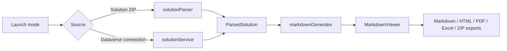

# PP-MD PPTB Edition Codebase Guide

## Purpose

PP-MD PPTB Edition is a React and TypeScript application that generates Power Platform solution documentation from either exported Solution ZIP files or a read-only Dataverse connection supplied by Power Platform ToolBox (PPTB).

The application has three deliberate boundaries:

1. **Collectors** read and normalise solution data.
2. **The shared model** represents ZIP and connected data consistently.
3. **Generators and viewers** render, search, and export documentation without needing to know where the data came from.

## Runtime flow



## Directory map

### Application shell

- `src/main.tsx` mounts React and global styles.
- `src/App.tsx` owns launch mode, queued files, selected Dataverse solutions, document settings, result navigation, export actions, and error/status presentation.
- `src/App.module.css` contains the shell layout, responsive header, grouped export menu, responsive hamburger menu, welcome screen, and app-level focus/layout styles.
- `src/assets/global.css` defines theme tokens, base typography, focus indicators, reduced-motion behaviour, print styles, and shared Markdown presentation.
- `public/` contains default document configuration data, browser/app icons, and the manifest icon copied into the built distribution.

### API and host integration

- `src/api/toolboxAPI.ts` wraps PPTB settings, notifications, connection access, clipboard, external browser, file-system, and Dataverse APIs.
- `src/api/fileManager.ts` provides typed export functions and routes downloads through PPTB when available, with browser fallbacks for local development.
- `src/api/excelExporter.ts` creates styled XLSX workbooks with overview (including optional document header details), table, relationship, process, app, integration, security, and automation sheets, plus one column sheet per table hyperlinked from the Tables sheet (each with a `Display Name (schema)` title row, a back link to Tables, and lookup target / option set columns). All sheet rows are sorted alphabetically on the first column and Description columns wrap.
- `src/api/documentRendering.tsx` holds shared Markdown sanitisation, heading slugs, standalone HTML building, SVG-to-PNG conversion, and `renderMarkdownDocument`, which renders Markdown plus Mermaid diagrams off-screen for the batch HTML/PDF ZIP export in `App.tsx`.
- `src/api/pdfExporter.ts` builds a genuine text-based, searchable PDF directly from the generated Markdown (parsed via `unified`/`remark-parse`/`remark-gfm`) using `jsPDF`'s text/table/image drawing APIs — not a screenshot of the rendered view. Mermaid diagrams are embedded as pre-rendered PNGs supplied by `MarkdownViewer`; everything else (headings, paragraphs, lists, tables, code, links) is drawn as real vector text. Unicode symbols outside jsPDF's WinAnsi font range are swapped for ASCII equivalents (`sanitizePdfText`).

### Data model and collectors

- `src/types/solution.ts` defines `ParsedSolution` and all normalised artefact types.
- `src/parser/solutionParser.ts` reads ZIP entries, XML, JSON, and modern artefact files with `JSZip` and `fast-xml-parser`.
- `src/dataverse/solutionService.ts` reads selected solution metadata through FetchXML, OData, and Dataverse metadata APIs. Connected collection is solution-component scoped and does not append environment-wide metadata.
- `src/dataverse/solutionService.test.ts` covers modern artefact capability fallbacks, environment-variable component scoping, value redaction, and collection policy behaviour.

### Documentation generation

- `src/generator/markdownGenerator.ts` converts `ParsedSolution` into deterministic Markdown sections, tables, TOCs, Mermaid diagrams, dependency insights, consolidated documents, category files, and companion diagram documents.
- The consolidated document is produced from `consolidateSolutions(...)`, so it uses the same complete artefact model as individual documents.
- `extractDiagramsDocument(...)` moves Mermaid sections into a standalone companion document when requested or when an individual document is too large/complex for comfortable viewing.

### User interface components

- `src/components/SolutionSidebar.tsx` lists individual solutions, the consolidated result, companion diagrams, and component counts.
- `src/components/ui/DropZone.tsx` handles keyboard-accessible ZIP selection and drag/drop.
- `src/components/ui/DataverseSolutionBrowser.tsx` searches, filters, sorts, selects, and refreshes connected solutions.
- `src/components/ui/MarkdownViewer.tsx` renders sanitised Markdown, Mermaid diagrams, raw Markdown, search highlights, copy, internal navigation, and per-document exports.
- `src/components/ui/MermaidDiagram.tsx` renders diagrams with textual captions and fallback content.
- `src/components/ui/ProgressBar.tsx`, `UpdateChecker.tsx`, and `ThemeToggle.tsx` provide status, update, and theme interactions.

### Supporting code

- `src/hooks/useToolboxAPI.ts` manages host detection, active connection initialisation, and connection state.
- `src/context/ThemeContext.tsx` manages light/dark theme state.
- `src/hooks/useUpdateCheck.ts` checks the current package version against GitHub releases when the user requests an update check.
- `scripts/check-contrast.mjs` verifies theme-token contrast.
- `scripts/validate-offline.cjs` checks package URLs and offline package constraints.
- `scripts/normalize-dist-assets.mjs` normalises built assets for PPTB packaging.

## Collection policy

Connected mode supports three policy values:

- `solutionOnly`: selected solution components only; this is the default.
- `solutionAndDirectReferences`: bounded direct-reference context, marked as enrichment rather than solution inventory.
- `environmentAppendix`: separate environment context; it must not be merged into solution sections.

Environment variables are resolved through `solutioncomponent` type `380`. Current-value records are checked only for presence, and live values are not queried or rendered.

## Export behaviour

- **Markdown** exports the active document.
- **HTML** exports the rendered sanitised document.
- **PDF** renders the generated Markdown directly into a text-based, searchable PDF (real text/tables/links, not a screenshot); Mermaid diagrams are rasterised from the already-rendered SVGs and embedded as images. The live generation notice remains present through the save-dialog handoff so users are not left with a locked interface and no status.
- **Excel** writes a styled workbook with separate sheets for major artefact families.
- **All Markdown** creates a ZIP containing individual documents, the consolidated document, companion diagrams, and optional dependency reports.
- **By Category** creates category folders for each individual solution and the consolidated document.

## Accessibility behaviour

The UI uses accessibility practices associated with WCAG 2.2 AA:

- semantic header, navigation, main, section, toolbar, search, list, table, and status landmarks
- skip link to the main content
- native buttons, inputs, selects, checkboxes, details/summary menus, and fieldsets
- shared toolbar typography so native buttons and summary-based menu triggers use identical font and baseline metrics
- visible keyboard focus indicators
- status and progress announcements with `aria-live` and `aria-busy`
- text captions and fallbacks for Mermaid diagrams
- sanitised Markdown and restricted generated badge classes
- reduced-motion support
- theme-token contrast audit for light and dark themes
- responsive reflow and a hamburger menu at narrow widths

These implementation practices do not establish WCAG conformance. Host-level screen-reader, forced-colours, zoom/reflow, and PPTB iframe checks require validation in the target host because the repository test runner does not emulate it.

## Validation workflow

```powershell
npm.cmd install
npm.cmd test
```

The full pipeline runs offline package validation, ESLint, TypeScript, Vitest, contrast checks, and the production build. Focused commands are available through `npm.cmd run type-check`, `npm.cmd run lint`, `npm.cmd run test:unit`, and `npm.cmd run test:contrast`.

Publishing uses `npm.cmd run finalize-package`, which runs the current PPTB manifest validator without network checks, builds the tool, confirms the declared entry point and SVG icon exist under `dist`, and performs an npm package dry run. Run `npm.cmd run validate` separately with network access before publishing to include official URL reachability checks.

## Change guidance

- Preserve the `ParsedSolution` contract when adding artefact families.
- Keep connected queries component-scoped and use explicit fields.
- Never add credentials or environment-variable live values to generated documentation.
- Add a focused regression test for each new collector or generator behaviour.
- Keep host-specific behaviour in `toolboxAPI.ts` and file export adapters rather than spreading host checks through presentation components.
