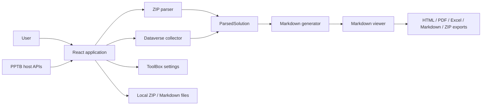

# PP-MD - PPTB Edition High-Level Design

## Overview

PP-MD - PPTB Edition is a client-side React and TypeScript tool for generating documentation about Microsoft Power Platform solutions. It supports two input modes:

- **Local Solutions:** the user selects exported solution ZIP files, which the tool parses in its runtime.
- **Dataverse Connected:** the tool reads selected solution metadata through the active Power Platform ToolBox (PPTB) connection.

The application is packaged as a PPTB tool with a Vite-built web entry point. It is not an Electron desktop application. During development, the same web application can run in a browser through Vite.

## Goals

- Produce structured, portable solution documentation.
- Keep ZIP parsing, normalisation, Markdown generation, rendering, and export in the client runtime.
- Keep connected collection read-only and scoped to the selected solution and its configured collection policy.
- Report source and availability differences without presenting environment data as solution content.
- Avoid querying or outputting credentials and secret configuration values.

## Architecture

The application separates input collection from the shared domain model and output generation. The host supplies platform services when the tool runs inside PPTB; local development uses browser fallbacks where implemented.

### Host boundary

Inside PPTB, the tool uses injected host APIs for connection access, Dataverse queries, settings, notifications, clipboard operations, theme information, and file saving. Authentication and connection credentials remain the host's responsibility. In local development, Dataverse-connected features are unavailable without the host; browser-compatible file, clipboard, theme, and local-settings fallbacks are used where supported.

### Application and collectors

- `src/App.tsx` coordinates launch mode, input selection, collection, generation, result navigation, configuration, and exports.
- `src/parser/solutionParser.ts` parses solution ZIP/XML and included artefact files.
- `src/dataverse/solutionService.ts` collects selected-solution data using PPTB's Dataverse API.
- Both collectors populate the `ParsedSolution` model in `src/types/solution.ts`.

### Generation and presentation

- `src/generator/markdownGenerator.ts` generates single-solution and consolidated Markdown, diagrams, and dependency output from the normalised model.
- `src/components/ui/MarkdownViewer.tsx` renders and searches Markdown, provides raw-source and copy controls, and coordinates document exports.
- `src/components/ui/MermaidDiagram.tsx` renders diagrams with textual/source fallbacks.
- Modules under `src/api/` adapt host file saving or browser downloads and create HTML, PDF, and Excel output.

## Data Flow

1. The user chooses ZIP input or selects a solution from the active PPTB Dataverse connection.
2. The corresponding collector parses or retrieves data and normalises it into `ParsedSolution`.
3. The generator creates solution documentation and, when enabled, consolidated output and companion diagrams.
4. The viewer renders the generated content and exposes navigation, search, and export controls.
5. Exports are saved through PPTB's file-system bridge in the host or browser download fallbacks during local development.

Connected collection uses the selected-solution component inventory by default. Optional direct-reference or environment-appendix collection is separately identified in the UI and output; availability depends on the host connection and Dataverse permissions. See [the codebase guide](codebase-guide.md) and [the Dataverse retrieval reference](research/dataverse-retrieval-reference.md).

## Technology and Build

- React 19, TypeScript, and Vite
- JSZip and fast-xml-parser for solution ZIP/XML parsing
- `react-markdown`, `remark-gfm`, and Mermaid for rendering and diagrams
- jsPDF and `xlsx-js-style` for PDF and Excel generation
- PPTB manifest entry point: `index.html`

`npm run build` runs TypeScript compilation, the Vite build, and the distribution-asset normalisation script. The manifest packages `dist`, `LICENSE`, and `README.md`. The tool does not include an Electron main process or Electron packaging targets. For the exact commands, see [package.json](../package.json) and [the codebase guide](codebase-guide.md).

## Security and Privacy

- Local ZIP processing is performed by the client-side tool; the repository does not implement a server upload path.
- Dataverse Connected mode makes read-only requests through the active PPTB connection; it is not offline processing.
- The tool does not intentionally query or render credentials, secure plug-in configuration, or live environment-variable values. Current-value reporting checks for non-null records without selecting their values and reports unknown when access or lookup resolution fails.
- Markdown and HTML rendering use sanitisation; output files are generated in the client runtime and saved by the host or browser.
- The page declares a Content Security Policy in `index.html`; the manifest separately declares the optional GitHub connection used by the update check.

These statements describe repository behaviour and do not imply that every host environment, connection permission, or export path has been independently security-tested.

## Accessibility

The UI includes semantic landmarks, keyboard-operable controls, status announcements, visible focus styles, reduced-motion support, and diagram text/source fallbacks. `npm test` includes the theme-token contrast audit. This is not a claim of WCAG conformance: screen-reader combinations, forced colours, zoom/reflow, and final behaviour inside PPTB still require host-level validation. See [the codebase guide](codebase-guide.md#accessibility-behaviour).

## Constraints and Assumptions

- ZIP coverage depends on the contents and shape of the exported solution files.
- Connected collection depends on the active host connection, permissions, and the availability of Dataverse endpoints or artefact types.
- The repository's automated tests do not reproduce the full PPTB host, so host-specific behaviour must be validated there.
- Large solutions can increase parsing, rendering, diagram, and export work; the application uses progress feedback and diagram rendering strategies to manage this workload.
